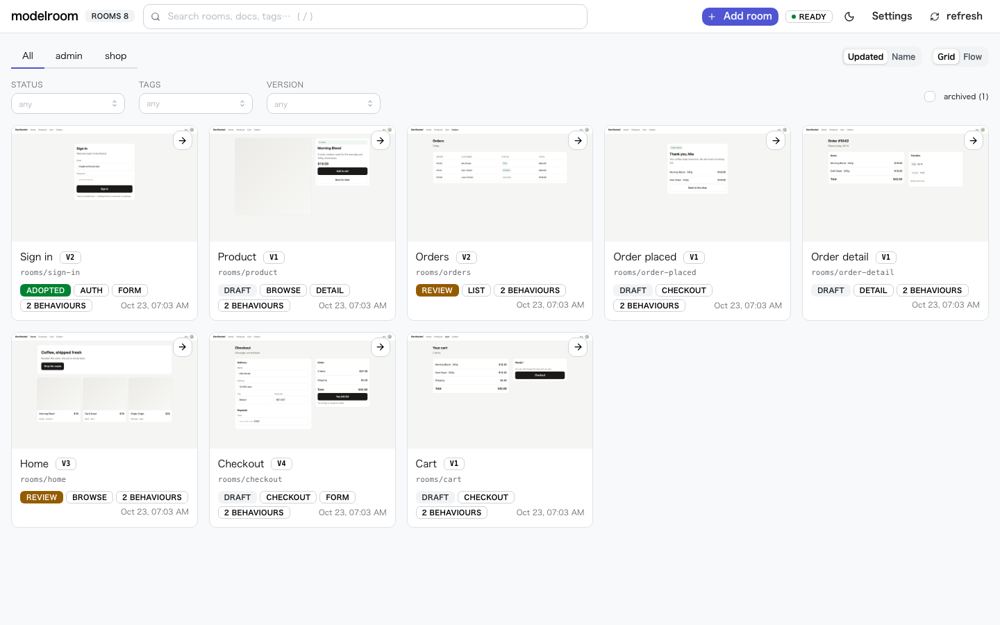
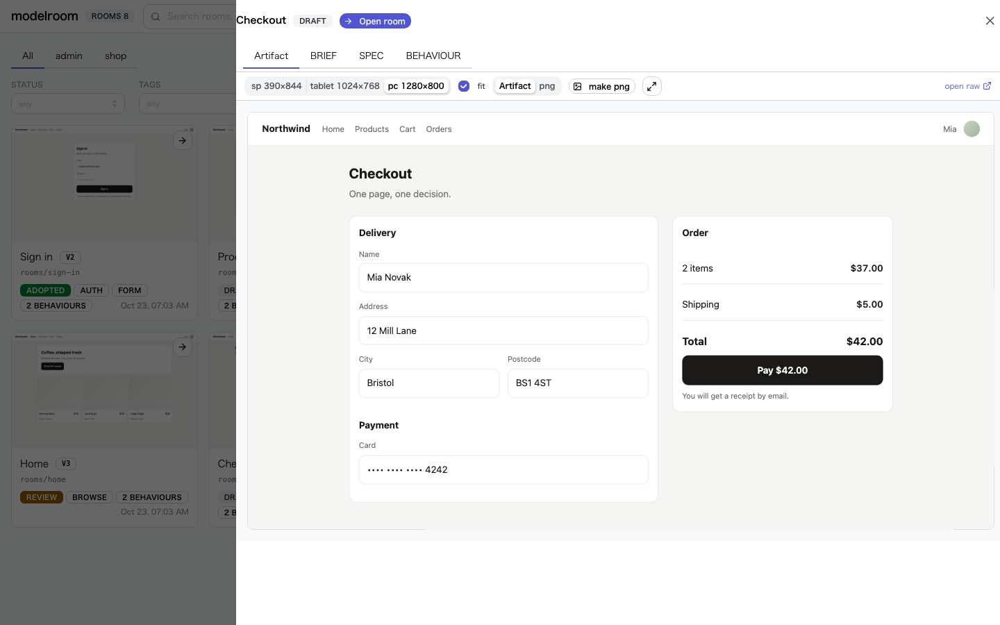
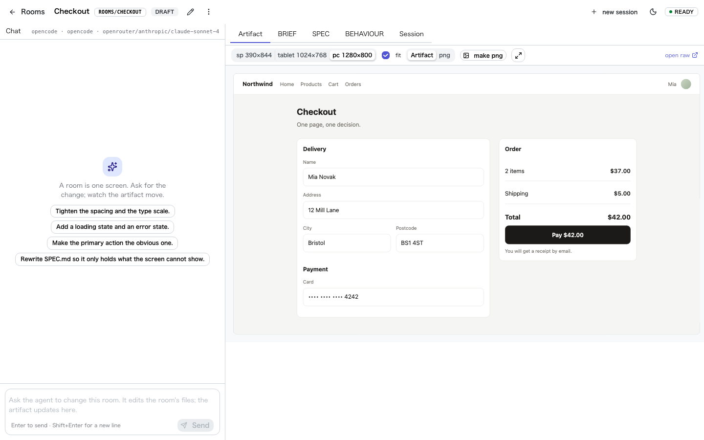
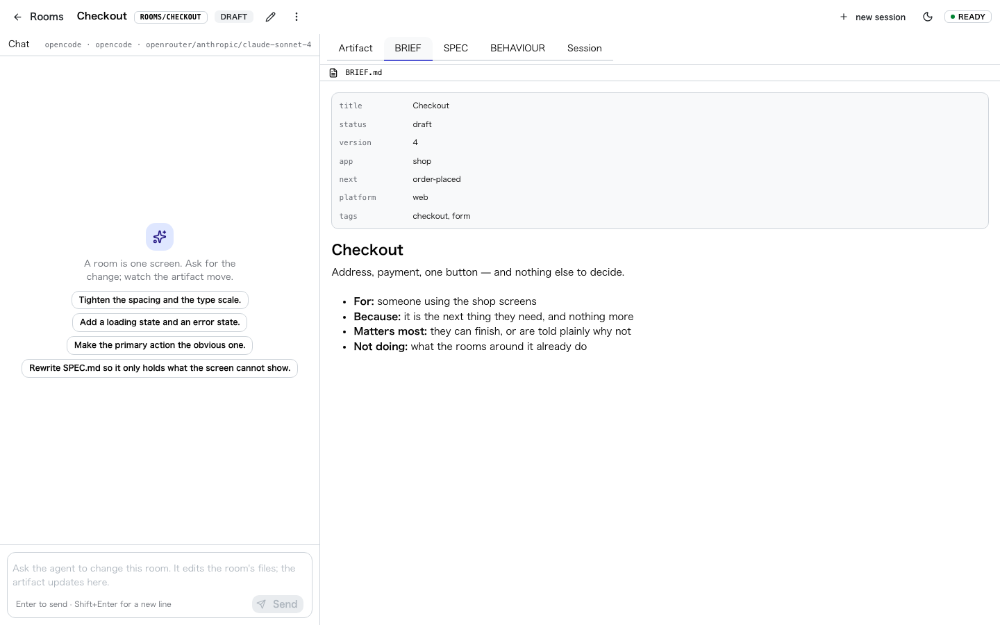
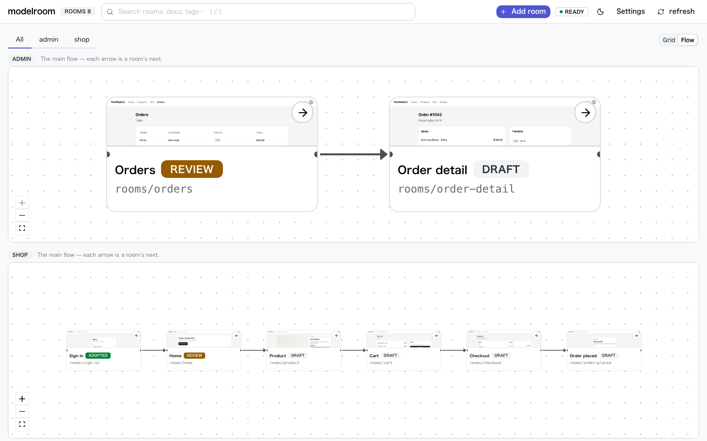
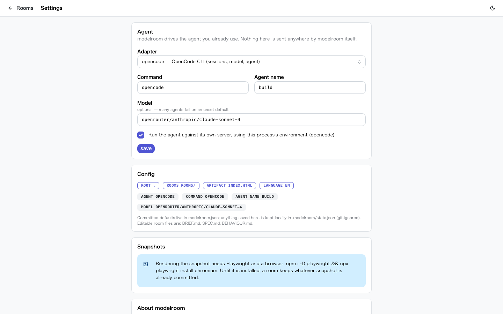
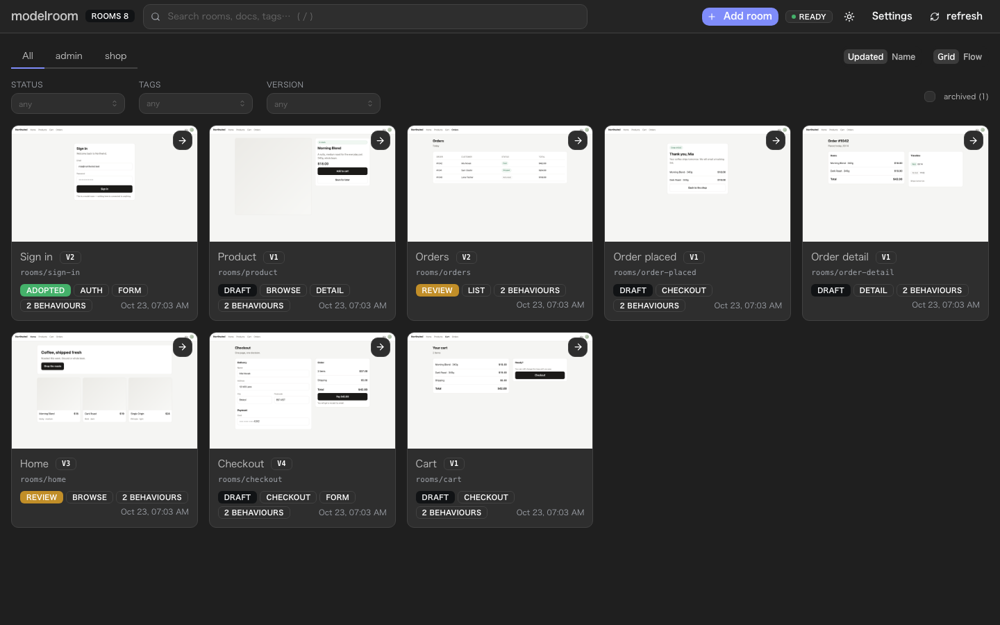

# modelroom

[](https://github.com/modelroom/modelroom/actions/workflows/ci.yml)
[](https://codecov.io/gh/modelroom/modelroom)
[](https://scorecard.dev/viewer/?uri=github.com/modelroom/modelroom)
[](https://www.npmjs.com/package/modelroom)
[](LICENSE)

**A full-scale model room for UI — convincing, not yet real.**

modelroom is a workspace for designing screens with coding agents. Each screen is a **room**:
a reason (`BRIEF.md`), an invisible spec (`SPEC.md`), a set of promises (`BEHAVIOUR.md`) and the
artifact (`index.html`) — kept apart, side by side, on one page.

It is agent-agnostic. Bring OpenCode, Claude Code, Codex, or any CLI. modelroom bundles no model
and no chat product: it gives your agent a place to work, and gives you a place to look.



```bash
npx modelroom init checkout    # asks the language, then a room with its docs
npx modelroom                  # → http://127.0.0.1:4321
```

`init` keeps the design layer in one place — `modelroom/` for what you commit and
`.modelroom/` for local state — and asks which language to use (↑/↓ then Enter; pass
`--lang en` / `--lang ja` to answer it without being asked):

```
your-repo/
├── modelroom/                 # committed
│   ├── modelroom.json
│   ├── AGENTS.md
│   ├── DESIGN.md
│   ├── .agents/skills/        # read-modelroom, create-modelroom-pr, manage-modelroom-rooms
│   └── rooms/checkout/
│       ├── BRIEF.md
│       ├── SPEC.md
│       ├── BEHAVIOUR.md
│       ├── index.html
│       └── index.png
└── .modelroom/                # git-ignored state
```

| Path | Committed? | What it is |
|---|---|---|
| `modelroom/modelroom.json` | yes | the config: agent, rooms, language |
| `modelroom/AGENTS.md` | yes | what the agent may write, and in which language |
| `modelroom/DESIGN.md` | yes | the layer's design rules: tokens, components, the design system and its MCP server |
| `modelroom/.agents/skills/` | yes | the agent's three skills: read the picture, put it in the PR, manage rooms |
| `modelroom/rooms/<room>/` | yes | one screen: `BRIEF`, `SPEC`, `BEHAVIOUR`, the artifact, its snapshot `index.png` |
| `.modelroom/state.json` | no | local session ids and settings changed from `/settings` |

`.modelroom/` is disposable: delete it to reset sessions and local settings. The committed
design layer is untouched.

If the repository already has a `package.json`, `init` also adds a `modelroom` script, so
the everyday command is `npm run modelroom` — the way `npm run storybook` works. The package
is installed with your own package manager (detected from the lockfile), so the script runs
the pinned local version; `--skip-install` writes that manager's runner instead
(`"pnpm dlx modelroom"`, `"npx --yes modelroom"`, …) and touches no dependencies, and
`--no-script` leaves `package.json` alone entirely. A `package.json` is never created:
`npx modelroom` stays the default for a project without one.

The command the layer tells your agent to run follows the same manager. `AGENTS.md`, the
skills and the CLI's `next:` line say `pnpm modelroom render <room>` in a pnpm project,
`npm run modelroom` in an npm one, and so on — never a hardcoded `npx`. That is what makes
it work in a project that pins its manager through `devEngines`: npm refuses every command
there, `npx modelroom` included.

## Why "model room"

A model room in real estate is furnished, full scale, and convincing enough to decide in — but it
is not the apartment you will live in. That is the point: decide here, build the real thing after.
The design layer is the model room; implementation is the building.

Because a room is **not** the real thing, the promises that only the real system can keep —
records, timestamps, rounding, permissions — do not live here. The design layer never reads your
application code.

## What you get

| Where | What |
|---|---|
| `/` | every room, side by side, with its snapshot — full-text search and filters built from the records. Click a room to preview it without leaving the list |
| `/rooms/<name>` | chat beside one tabbed surface: the artifact, the room's docs, and the session — updating as the agent works |
| `/settings` | which agent to run, and with which model |
| `/files/<path>` | the design layer (`modelroom/`), served read-only and **unmodified** (no injected scripts) |

**The dashboard** is the front page: every room, its snapshot, and the facets the records build.
Click a room and it opens from the right — a preview, not a page.



**A room** is one screen: the chat on the left, and one tabbed surface on the right — the artifact,
the docs, and the session.



**The docs** are read-only and rendered, with a diff against the last version you looked at.



**The flow** draws each app's screens and wires them by `next`, so a product's shape is one glance.



**Settings** is where the agent is chosen — which CLI, which agent, which model.



<details>
<summary>The same dashboard, dark</summary>



</details>

A room's docs are read-only in the UI — you change them by asking the agent. Changing `index.html`
(from the agent or by hand) reloads the preview with no manual refresh; changes elsewhere in the
room stream in the same way.

Each room also keeps `index.png` — its artifact rendered, committed under a fixed name. That is
the picture a reviewer reads: it shows on the dashboard, and a pull request diffs it under
**Files changed**. Rendering needs Playwright; reading a snapshot does not, which is why it is
committed. See [`docs/05-preview-images.md`](docs/05-preview-images.md).

## The convention in one table

| File | Answers | Shown to |
|---|---|---|
| `BRIEF.md` | why does this room exist? | director, everyone |
| `SPEC.md` | what the artifact cannot show (devices, states, constraints, what it may use) | designer, agent, implementer |
| `BEHAVIOUR.md` | what it promises (operations and results) | tests, implementer |
| `index.html` | what it looks like — the artifact itself | director, owner, implementer |

Two rules do the work: **the artifact owns what is visible** (specs never restate it), and **a
statement lives in one file** (others reference it by id). See [`docs/02-convention.md`](docs/02-convention.md).

Each room's frontmatter is its record. A few keys are reserved (`title`, `summary`,
`key_points`, `tags`, `status`, `version`, `deprecated`, `superseded_by`, `device`);
**everything else becomes a facet on the dashboard automatically** — a string turns into
a select, a list into checkboxes, built from the values that actually exist. Search covers
the docs, not just the titles. `device` is also how a room picks the screen its snapshot
is rendered at; `docs/03-cli.md` has the details.

```yaml
---
title: Sign in
status: draft
version: 1
summary: A boring front door — signed in, or told plainly why not.
tags: [auth, form]
---
```

An agent adds; it does not delete. Retiring a room is `deprecated: true` plus
`superseded_by: <room>`, so the record stays and git can bring it back. `modelroom check`
verifies the convention without writing anything. `adopted` is a human decision — an agent
must never set it.

Rooms are made, renamed and removed with the CLI — `npx modelroom add`, `rename`, `remove`
— so the unique directory name and the references to it move together. `modelroom update`
refreshes the generated skills and `AGENTS.md` when you upgrade; `DESIGN.md` is yours and is
left alone. `serve`, the dashboard and `doctor` say when a newer modelroom exists, with the
command that fits this project — and modelroom never installs it for you.

What every room shares is shared **once**. `DESIGN.md` records the decisions, `design.css`
holds the layer's own tokens and components, and a vendored design system lives under
`vendor/`; a room links both by relative path, so the artifact still renders offline. No CDN,
no per-room copy of the framework, no build step.

## Agents

```jsonc
// modelroom/modelroom.json
{
  "root": ".",
  "rooms": "rooms",
  "state": "../.modelroom",
  "lang": "ja",                                // optional; init writes it when you answer
  "agent": {
    "adapter": "opencode",                       // or "command" for any CLI
    "command": "opencode",
    "agent": "build",
    "model": "openrouter/deepseek/deepseek-v4.1-flash",
    "standalone": true
  }
}
```

`adapter: "command"` runs anything: `{ "command": "claude", "args": ["-p", "{prompt}"] }`.
Full detail, including how to scope an agent so it can only write room files, is in
[`docs/04-agents.md`](docs/04-agents.md).

## From source

```bash
git clone https://github.com/modelroom/modelroom && cd modelroom
npm install                 # dev only: builds the UI (Mantine + React bundled) + playwright (optional)
npm test                    # smoke checks
npm run modelroom           # serves templates/en/example/rooms
npm run build:css           # after changing web/*.html or client/modelroom.css
npm run build:client        # after changing client/**
```

`npm install` builds the stylesheet and the JS bundle in `web/` (via `prepare`), and the
published package ships them already built, so users never run a build step; neither file is
committed. The tool's UI is React + [Mantine](https://mantine.dev); the artifacts (in
`templates/`) are deliberately plain HTML and CSS — no CDN, no web fonts, no build step —
because they are handed to implementation and must render with no network. A project that
adopts a design system can keep one copy for the whole layer and link it from its rooms: see
[`docs/02-convention.md`](docs/02-convention.md).

Snapshots need Playwright to be rendered; reviewing them needs nothing:

```bash
npm i -D playwright && npx playwright install chromium
modelroom render --all          # bring every room's index.png up to date
modelroom render --all --check   # CI: is a snapshot out of date?
```

## Development

```bash
npm ci
npm run dev        # serve, watching the source
npm run verify     # lint, types, format, tests, build — the same gates as CI
```

Source is TypeScript (erasable syntax only) and runs directly on Node 22.18+. `npm run build`
emits `dist/` with declarations; that is what npm publishes. See
[CONTRIBUTING.md](CONTRIBUTING.md) for the rules.

## Docs

- [`docs/01_concept.md`](docs/01_concept.md) — the layers, their audiences, the one-way dependency
- [`docs/02-convention.md`](docs/02-convention.md) — the files, the rules, the naming
- [`docs/03-cli.md`](docs/03-cli.md) — commands and configuration
- [`docs/04-agents.md`](docs/04-agents.md) — adapters and how to write one
- [`AGENTS.md`](AGENTS.md) — for agents working **on** modelroom

## What it is not

- Not an app builder (v0, Lovable, bolt.new). Those put chat first; this puts the room first.
- Not a fork of anything. It is a convention plus a small local server.
- Not a replacement for your agent. It drives the one you already use.
- Not an installer. It tells you when a newer modelroom exists and prints the command that
  fits your project; it never writes your `package.json` or lockfile.

## Status

Early (`0.0.1`) — the first release. The convention comes from a real project; expect churn.

## License

MIT
